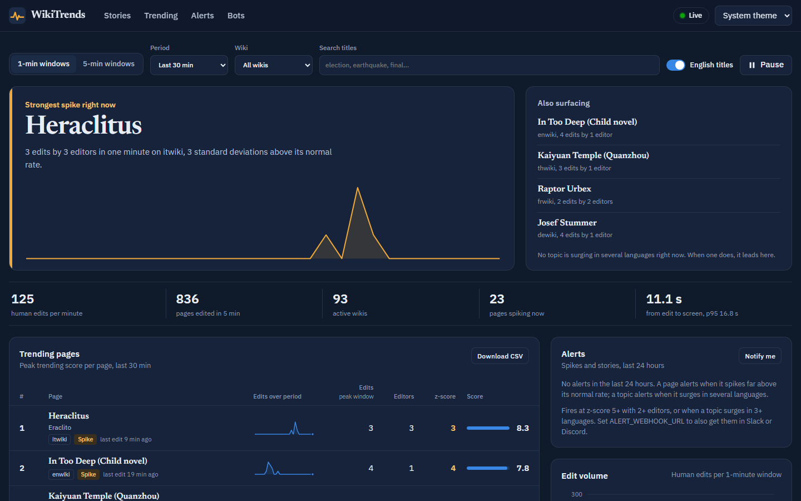
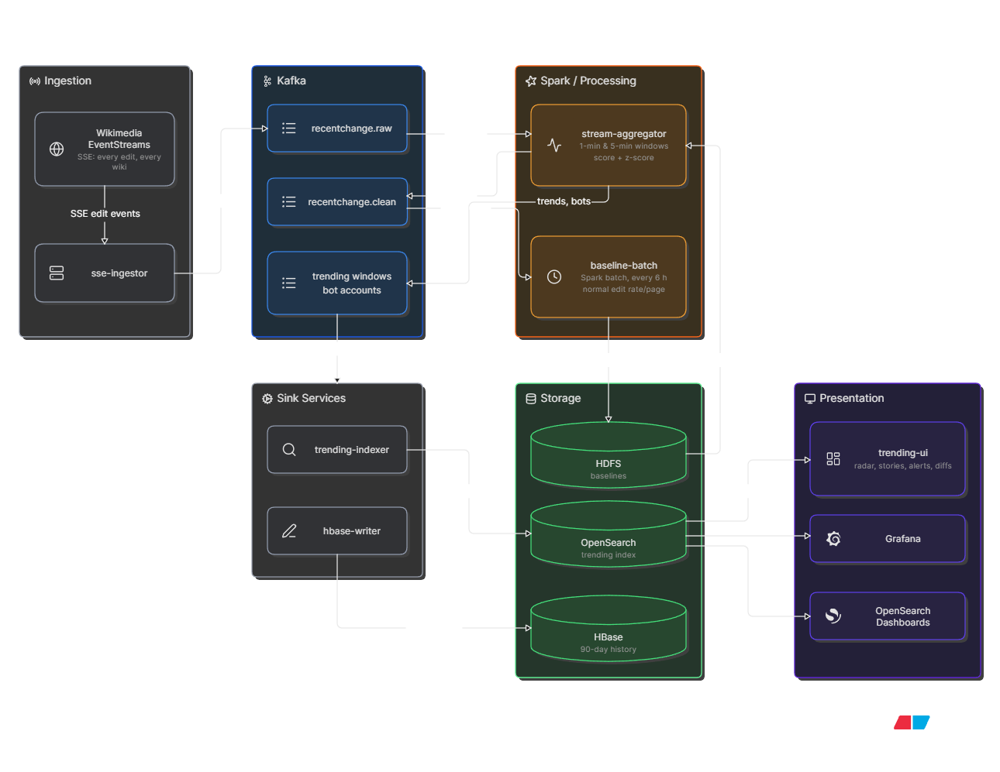

# WikiTrends

**A live breaking-news radar built from Wikipedia edits.**

When something happens in the world (a death, an earthquake, a match, an election), Wikipedia
editors react within minutes, often in several languages at once. WikiTrends watches every
edit on every Wikimedia wiki and does four things:
- flags the pages being edited far more than usual;
- groups the same topic across languages;
- shows exactly what changed;
- alerts you.



## Who it's for

- **Journalists and OSINT researchers:** spot events early. A topic surging in five language
  editions at once is a strong, independent signal that something real is happening.
- **Wikipedia patrollers:** find contested pages (editors reverting each other), read each edit's
  diff in place, and watch what bots are doing.
- **Students and data engineers:** a complete, working streaming pipeline (Kafka, Spark
  Structured Streaming, HDFS, HBase, OpenSearch) that runs on a laptop with one command.

## Quick start

You need Docker with Compose v2 and about 8 GB of RAM for containers.

```bash
cp .env.example .env            # optional: put your contact in USER_AGENT, add a webhook
docker compose up -d --build    # first run downloads images: allow a few minutes
./scripts/smoke-test.sh         # waits until data flows end to end (2 to 4 min)
```

Open **http://localhost:8000**.

Everything is set up automatically: Kafka topics, OpenSearch templates and retention, the
Grafana plugin and dashboard, and the HBase table. Stop the stack with `docker compose down`,
or wipe all its data with `docker compose down -v`.

## What you get

| Section | What it shows |
|---|---|
| **Lead** | The strongest signal right now. A topic surging in several languages leads when there is one; otherwise the biggest single-page spike. |
| **Also surfacing** | The next stories or spikes. |
| **Vitals** | Human edits per minute, active pages and wikis, pages spiking, and the delay from an edit to your screen. |
| **Trending pages** | Top 25 pages by trending score, with sparklines, rank changes and badges: *New page*, *Spike* (z ≥ 3), *Contested* (2+ reverts in a minute), *N languages*. Export to CSV. |
| **Page view** | Click any page: Wikipedia summary, **what changed** (the latest edit's diff with author, summary and size, plus older/newer navigation), edit and z-score charts, and a shareable link. |
| **Alerts** | Spikes and multi-language stories from the last 24 h. Optional browser notifications and Slack/Discord posts. |
| **Bot activity** | Bot share of edits, humans vs. bots over time, the most active bots, the most automated wikis. |

Other details:
- Non-English pages show their English title when an English article exists (switchable).
- Filters (window size, period, wiki, title search) live in the URL, so any view can be shared.
- Light and dark themes; works on phones.

Other UIs, for the curious:

| URL | What |
|---|---|
| http://localhost:8000/api/docs | The API behind the radar (OpenAPI) |
| http://localhost:3000 | Grafana dashboard |
| http://localhost:5601 | OpenSearch Dashboards |
| http://localhost:8080 | Spark |
| http://localhost:9870 | HDFS |
| http://localhost:16010 | HBase |

## Alerts

An alert fires when either of these happens:

- **Spike:** a page's z-score reaches `ALERT_MIN_Z` (default 5) with at least
  `ALERT_MIN_EDITORS` (default 2) different editors in one minute.
- **Story:** one topic surges in at least `ALERT_MIN_LANGUAGES` (default 3) language editions.

Each topic alerts at most once per `ALERT_COOLDOWN_MINUTES` (default 60), even across restarts.

To get alerts in chat, create an *incoming webhook* in Slack or Discord and put its URL in `.env`:

```bash
ALERT_WEBHOOK_URL=https://hooks.slack.com/services/...   # or a Discord webhook URL
PUBLIC_UI_URL=http://your-host:8000                       # link included in each message
```

Then run `docker compose up -d trending-ui`. For alerts in your browser, click **Notify me**
in the Alerts panel.

## How it works



| Service | Job |
|---|---|
| `sse-ingestor` | Streams Wikimedia edits into Kafka, keyed by page. Resumes where it left off after a restart. |
| `stream-aggregator` | Spark Structured Streaming. Counts edits, editors, bytes, reverts and page creations per page in sliding windows (1 min every 30 s, 5 min every 60 s), separately for humans and bots, and scores each window against the page's baseline. |
| `baseline-batch` | Spark batch job. Learns each page's normal hourly edit rate from the last 72 h of history and publishes it for the stream, which picks it up without restarting. |
| `trending-indexer` | Writes windows to daily OpenSearch indices. Safe to replay: a window is always the same document. |
| `hbase-writer` | Keeps 90 days of per-page window history in HBase. |
| `trending-ui` | The radar page and its API. Groups pages into stories, looks up English titles, runs the alert engine. |
| `*-init` services | One-shot setup jobs. They are safe to re-run. |

### How "trending" is decided

For each page and window:

```
activity = edits + 1.5·(editors − 1) + 0.25·ln(1 + bytes changed) + [page created] − reverts
z        = (edits − expected) / σ        expected and σ come from the page's own baseline
score    = activity + 0.5 · clamp(z, 0, 20)
```

- **More people beats more edits:** each additional editor counts more than another edit by
  the same person.
- **Size barely matters:** one huge edit can't outrank a page many people are editing.
- **z rewards the unusual:** a page busier than *it* normally is scores higher. A page with no
  baseline yet is compared against zero.
- **Stories** group pages by their Wikidata item, so the German, French and Spanish articles on the
  same earthquake count as one topic.
- **Sliding windows overlap:** each edit appears in two 1-minute windows (or five 5-minute ones).
  Totals are computed per window end time, or divided by the overlap, never naively summed.

## Configuration

Every setting has a default. See `.env.example` for the full list.

| Variable | Default | What it does |
|---|---|---|
| `USER_AGENT` | (set in compose) | Sent to Wikimedia, whose policy requires contact details. Use your own. |
| `NAMESPACES` | `0` | Which namespaces count (0 = articles). |
| `TRACK_BOTS` | `true` | Aggregate bot edits for the bot section. They never count toward trending. |
| `RETENTION_DAYS` | `7` | How long OpenSearch keeps window data and alerts. |
| `BASELINE_INTERVAL_HOURS` | `6` | How often baselines are recomputed. |
| `ALERT_*`, `PUBLIC_UI_URL` | see [Alerts](#alerts) | Alert thresholds and delivery. |
| `SPARK_WORKER_MEMORY` / `_CORES` | `3G` / `3` | Size of the Spark worker. Lower it on small machines. |

Which wikis are ingested is set in `apps/sse-ingestor/config.yml`.

## Everyday commands

```bash
docker compose ps                                          # what's running
docker compose logs -f stream-aggregator                   # follow one service
docker compose run --rm -e RUN_ONCE=true baseline-batch    # compute baselines now
docker compose restart trending-ui                         # after changing alert settings
```

| Problem | Check |
|---|---|
| The page says "Waiting for data" for more than 3 minutes | `docker compose logs sse-ingestor` should say `connected to https://stream.wikimedia.org/...`. |
| No z-scores | Baselines need history. The first scheduled run is 60 minutes after start; run it now with the command above. |
| A container keeps restarting | Docker may be short of memory. Set `SPARK_WORKER_MEMORY=2G` in `.env`. |
| Stories are empty | Normal in quiet hours. Overlap between languages mostly happens around real news. |

## Development

```bash
uv sync --group dev
uv run ruff check .
uv run pytest
```

The logic of each service lives in small modules with unit tests in `tests/`:
- event filtering;
- document ids and HBase row keys;
- scoring queries;
- story grouping;
- alert rules;
- title lookups.

CI runs lint, tests, a compose check and image builds on every push. A manual run can also start
the whole stack and run the smoke test.

```
apps/
  sse-ingestor/        Wikimedia → Kafka (filters in config.yml)
  stream-aggregator/   Spark streaming job
  baseline-batch/      Spark batch job + scheduler
  trending-indexer/    Kafka → OpenSearch
  hbase-writer/        Kafka → HBase
  trending-ui/         API, stories, alerts, English titles, static/ (the radar page)
  bootstrap/           OpenSearch and Dashboards setup jobs
conf/                  Kafka topics, OpenSearch templates and retention, Grafana
scripts/               smoke-test.sh
tests/
```

## Design notes and limits

- **Wikidata is not ingested.** Its items are titled by id ("Q56876694"), and most of its bulk
  editing comes from human accounts using batch tools, which no bot filter catches. In a sample
  it was ~24% of all edits. Remove it from `exclude_wikis` in `apps/sse-ingestor/config.yml` to
  include it.
- **Bots make about a third of article edits** (44% of all edits in a 45-second sample across
  every namespace). They are tracked in their own section and never affect trending, baselines or
  alerts.
- **English titles and Wikidata ids** are looked up from each wiki's API by `trending-ui`, cached
  for hours, and batched 50 titles per request. Search still matches original titles.
- **Diffs** are fetched by your browser straight from the wiki's public API. The returned HTML is
  rebuilt from text, never inserted as markup.
- **Security:** this is a local stack. OpenSearch runs without its security plugin, Grafana allows
  anonymous viewers, and all ports are published. Put it behind authentication before exposing it.

### Upgrading from v1

- The compose project is now called `wikitrends`, so v1 volumes are left untouched.
- Spark checkpoints moved to `checkpoints/stream-agg-v3`.
- `opensearch-init` migrates an old `trending-1m` / `trending-5m` index automatically and adds new
  fields to existing indices, so no reset is needed.

---

Data comes from [Wikimedia EventStreams](https://stream.wikimedia.org/?doc) and each wiki's public
API. Article text belongs to its authors under the wiki's license.
